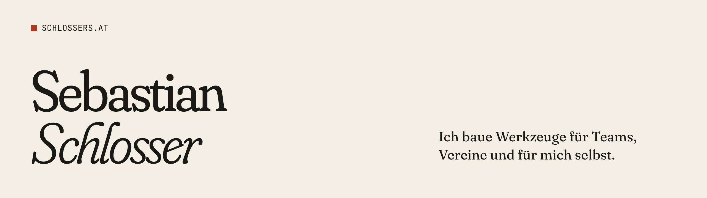

<a href="https://schlossers.at">
  <picture>
    <source media="(prefers-color-scheme: dark)" srcset="assets/banner-dark.png">
    
  </picture>
</a>

 

Softwareentwickler aus Österreich. Ich schreibe Software meistens dann, wenn mir oder Leuten um mich herum ein Werkzeug fehlt: dem CS2-Team ein Trainingsserver, dem Verein eine Kasse, mir selbst ein Überblick über KI-Kosten.

### Projekte

- **[VNC Beach](https://reals3bi.github.io/vnc-beach/)**: VNC-Server und -Viewer für macOS und Windows, gratis und Open Source. In Rust, kompatibel mit Standard-VNC.
- **[Clunema](https://clunema.com)**: Vereinssoftware aus Österreich mit Terminen, Beiträgen, Umfragen und Nachrichten für Mitglieder und Teams. Dazu eine Kassa, die auch ohne Internet bucht.
- **[Playbook](https://github.com/realS3BI/playbook)**: Plattform für Counter-Strike 2 mit Lineups, Granatentraining im Spiel, Teams und Strats, Demoanalyse und Serververwaltung. Mit eigenem CounterStrikeSharp-Plugin, Ingame-HUD und Windows-App.
- **[Music & AI Hackathon](https://github.com/realS3BI/hackathon-steckbrief)**: Musik-Wissensbasis mit einem Creator, der Instrumentalstücke im Browser erzeugt. Beitrag zur Challenge „Accessibility & Music“.
- **[vaultship](https://github.com/realS3BI/vaultship)**: CLI für Releases in einem Befehl und verschlüsselten `.env`-Sync zwischen Rechnern. Auf [npm](https://www.npmjs.com/package/vaultship).
- **[dns-manager](https://github.com/realS3BI/dns-uploader)**: DNS-Zonen verwalten mit Hetzner-Anbindung und Login über GitHub oder Google.
- **[AI Cost Tracker](https://github.com/realS3BI/ai-tracker)**: Kosten und Limits von Codex, OpenAI, OpenRouter und Cursor an einem Ort, im Browser oder auf der Kommandozeile.
- **[Regau Cash App](https://github.com/realS3BI/regau-cashapp)**: Kassen-App für Vereinsteams als PWA, mit Echtzeit-Admin-Bereich.

### Werkzeuge

TypeScript, React, Next.js, Convex und Node.js für das meiste. Rust, wenn es schnell und nah am System sein muss. Dazu C#, Python, Docker und Tailscale.

### Kontakt

[schlossers.at](https://schlossers.at) · [sebastian@schlossers.at](mailto:sebastian@schlossers.at)
