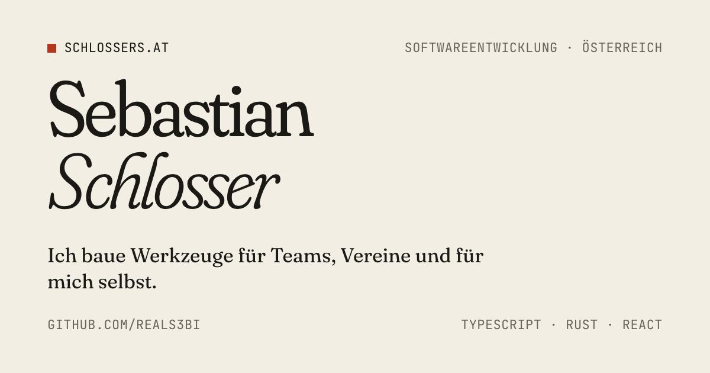

# schlossers.at

Persönliche Website von Sebastian Schlosser: Projekte, Über mich, Kontakt.



Reines HTML und CSS, ohne Build-Schritt, ohne JavaScript, ohne Cookies und ohne Inhalte von Drittanbietern. Die Schriften [Fraunces](https://github.com/undercasetype/Fraunces) und [JetBrains Mono](https://github.com/JetBrains/JetBrainsMono) liegen im Repo (SIL Open Font License).

## Aufbau

| Pfad | Inhalt |
| --- | --- |
| `README.md` | GitHub-Profil, nicht Teil der Website |
| `assets/` | Banner fürs GitHub-Profil, hell und dunkel |
| `site/` | Die Website, so wie sie ausgeliefert wird |
| `site/assets/style.css` | Farben, Schriften und Abstände als CSS-Variablen, darunter alle Stile |
| `design/card.html` | Vorlage für das Vorschaubild `site/og.png` und das Banner im GitHub-Profil |
| `.github/workflows/pages.yml` | Veröffentlicht `site/` bei jedem Push auf `main` über GitHub Pages |

## Lokal ansehen

```sh
python3 -m http.server 4173 --directory site
```

Dann [localhost:4173](http://localhost:4173) öffnen.

## Ein Projekt hinzufügen

In `site/index.html` einen weiteren `<li class="project">`-Block in die Liste `ol.projects` kopieren. Die Nummerierung zählt CSS automatisch mit. Die Projektliste im Profil-`README.md` gleich mitziehen.
